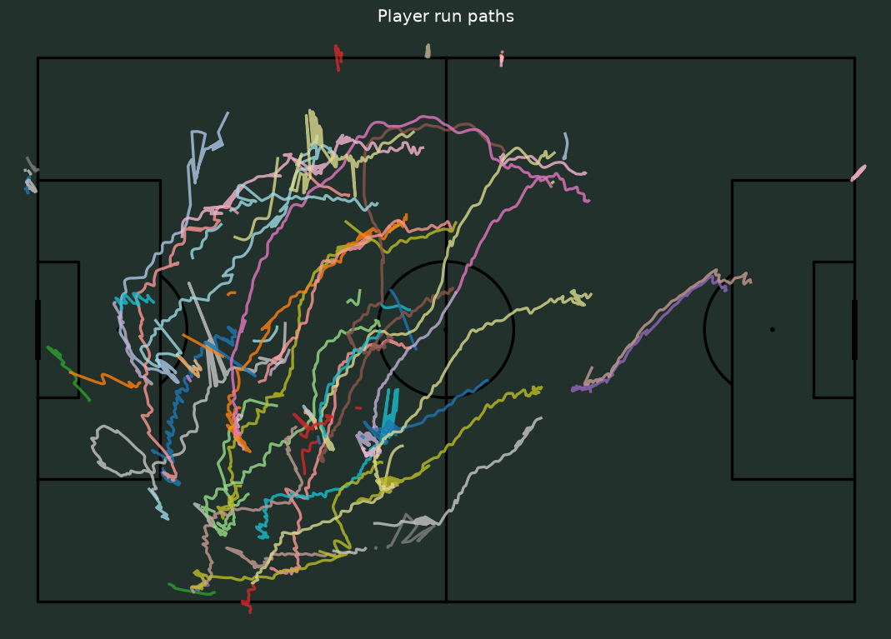
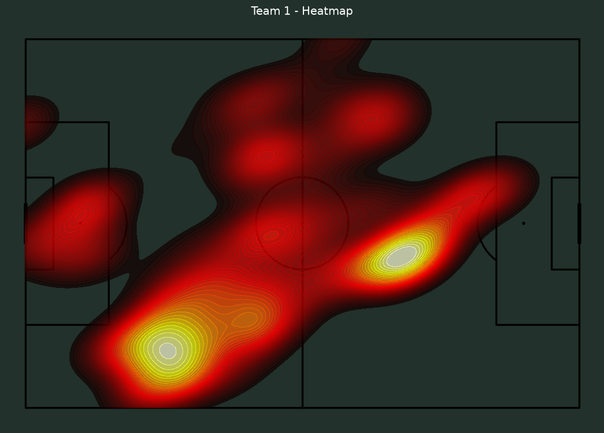

# ⚽ Football Analysis — Multi-Camera Player Tracking

> An end-to-end computer-vision pipeline that turns amateur multi-camera football
> footage into **calibrated, StatsBomb-format player-tracking data** — camera-motion
> estimation, pitch calibration, detection, multi-object tracking, multi-camera
> fusion, and an interactive review tool. Built from scratch as a solo project.



<p align="center"><sub>Run paths of all tracked players, fused from three camera views onto a single pitch.</sub></p>

---

## What it does

Amateur clubs record matches with fixed multi-camera systems (e.g. Veo), but the raw
video is just that — video. This project reconstructs **where every player is, in real
pitch coordinates, on every frame**, and exports it in the same format professional
analysts use (StatsBomb, 120×80). From there: run paths, heatmaps, distances covered,
team shape, and more.

The hard parts — a moving virtual camera, tiny far-away players, players occluding each
other, and stitching three overlapping views into one consistent identity per player —
are solved step by step, and every step is validated **visually**, not just by metrics.

## Highlights

- **Camera-motion module** — estimates a per-frame homography onto a reference frame
  (ORB features on a grass mask, direct-to-reference matching, temporal smoothing, a
  photometric verifier that checks the chosen transform each frame).
- **Pitch calibration** — image↔pitch homography (least-squares) from the real venue
  dimensions, with snap-to-line/circle and a leave-one-out consistency advisor.
- **Detection + cleanup** — a football-specific YOLO model used as an offline
  auto-labeler, then two-stage deduplication (body-part fragments, glued track pairs),
  ball/artifact removal, and an off-field filter for spectators and staff.
- **Tracking** — ByteTrack driven directly on the pre-computed boxes, with association
  done in the **stabilized reference frame** so camera pan no longer breaks it
  (Kalman + Hungarian).
- **Multi-camera fusion** — spatio-temporally coincident tracks across the three views
  are merged into **global player IDs** via union-find, with automatic frame-offset sync.
- **Interactive review tool** (`tools/review/`) — a local browser app backed by a Python
  **standard-library** server: three synced videos with overlays, per-camera **and**
  global ID filtering, A/B comparison of two runs, a coupled run-path pitch map,
  per-track feedback capture, and dated nightly snapshots.
- **Analytics** — run paths, team heatmaps, player distances (real metres), team
  compactness and formation, all in StatsBomb pitch coordinates.

## Project structure

```text
football-analysis/
├── src/                  Core pipeline — importable Python package
│   ├── motion/             Camera-motion estimation (per-frame homography)
│   ├── calibration/        Image↔pitch homography, venue geometry, snap/advisor
│   ├── detection/          Detection parsing, de-duplication & filters
│   ├── tracking/           ByteTrack driver, stitching, smoothing, appearance
│   ├── analytics/          Teams, possession, events, physical metrics, plots,
│   │                       multi-camera assembly (global IDs)
│   ├── visualization/      Pitch overlays, annotated video rendering
│   ├── export/             StatsBomb / CSV export
│   └── pipeline · config · core · video · evaluation
├── tools/                Command-line tools + the review web app
│   └── review/             Local browser tool: synced review, A/B, feedback
├── config/               Per-clip configs, calibrations, tracker settings
├── docs/                 Early planning docs (vision, strategy, data model — German)
├── test/                 Unit tests
├── assets/               Images used in this README
├── ARCHITECTURE.md       Detailed, up-to-date module-by-module reference (German)
└── PLAN.md               Prioritized roadmap & changelog
```

## Tech stack

**Python** · OpenCV · ultralytics YOLO · ByteTrack · Kalman filter + Hungarian
assignment · projective geometry / homography · NumPy · Pandas · mplsoccer ·
HTML / JS / Canvas · StatsBomb data format

## Running it

```bash
pip install -r requirements.txt

# rebuild the production tracking for the test clips
python -m tools.xmodel_pipeline
# merge the three cameras into global player IDs
python -m tools.assemble_x
# launch the interactive review tool  →  http://127.0.0.1:8731/
python -m tools.review.server
```

> The pipeline needs source footage and a football-trained YOLO model, which are **not**
> included (see *Data & privacy* below). Point it at your own Veo-style clips.

## Example outputs

| Run paths (whole match, fused) | Team heatmap |
|:---:|:---:|
|  |  |

## Engineering approach

- **Visual proof over metrics** — every change is validated against rendered images;
  more than once a metric (track count, a brightness score) was misleading and only the
  picture told the truth.
- **Measure before fixing** — problems are characterized on the real data before any
  threshold is touched.
- **Honest negative results** — approaches that regressed on this material were rejected
  rather than shipped, and the remaining limitations are named explicitly.
- **Living documentation** — see [`ARCHITECTURE.md`](ARCHITECTURE.md) (module reference)
  and [`PLAN.md`](PLAN.md) (roadmap + changelog).

## Status & limitations

A working prototype on ~20-second test clips, CPU-only. The main open problems —
same-team ID switches at crossings, and running a full 90-minute match at scale — need a
re-identification model and GPU acceleration. Current state and next steps live in
[`PLAN.md`](PLAN.md).

## Data & privacy

The raw footage shows **real people** and is intentionally **not** part of this
repository, for privacy reasons; model weights and generated outputs are excluded for
size. The code is the deliverable. Third-party dependencies carry their own licenses
(notably ultralytics YOLO under AGPL-3.0).

---

<sub>Solo project · computer vision · multi-object tracking · sports analytics.</sub>
